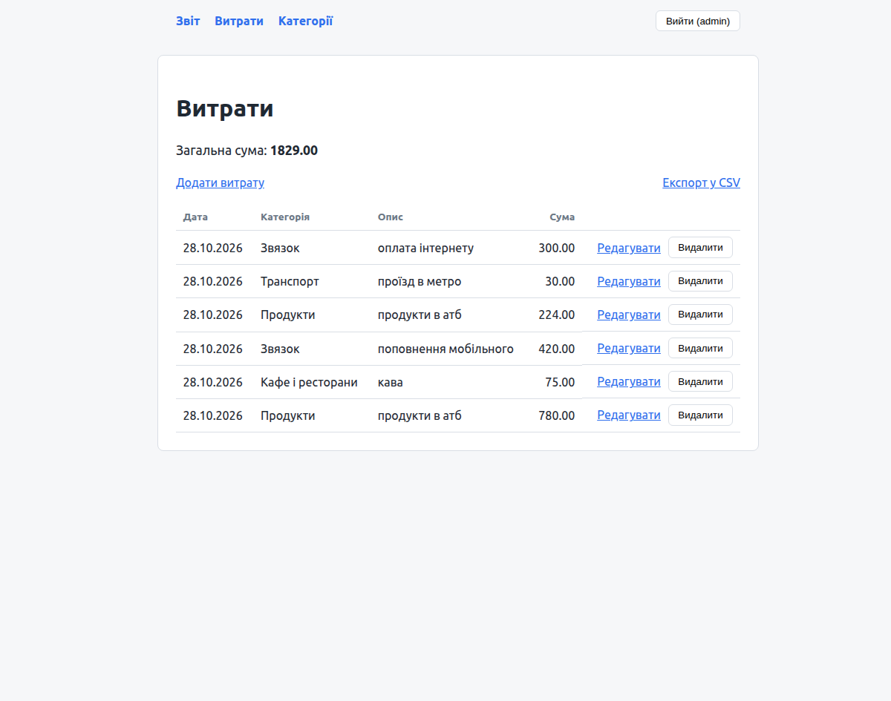
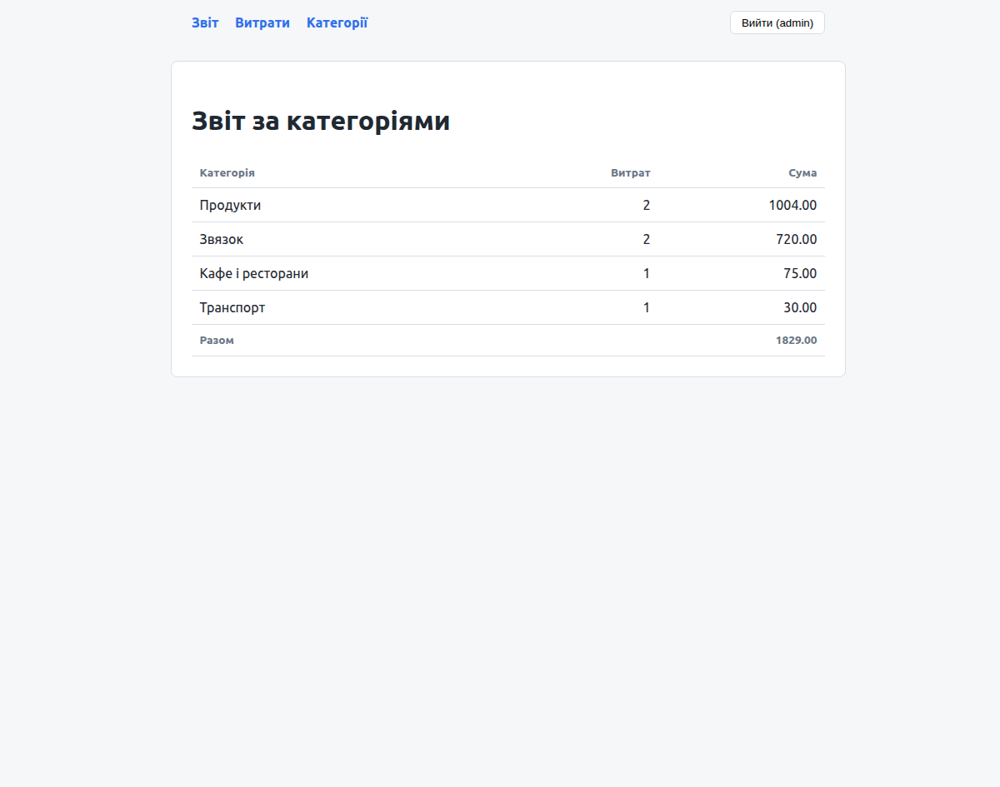
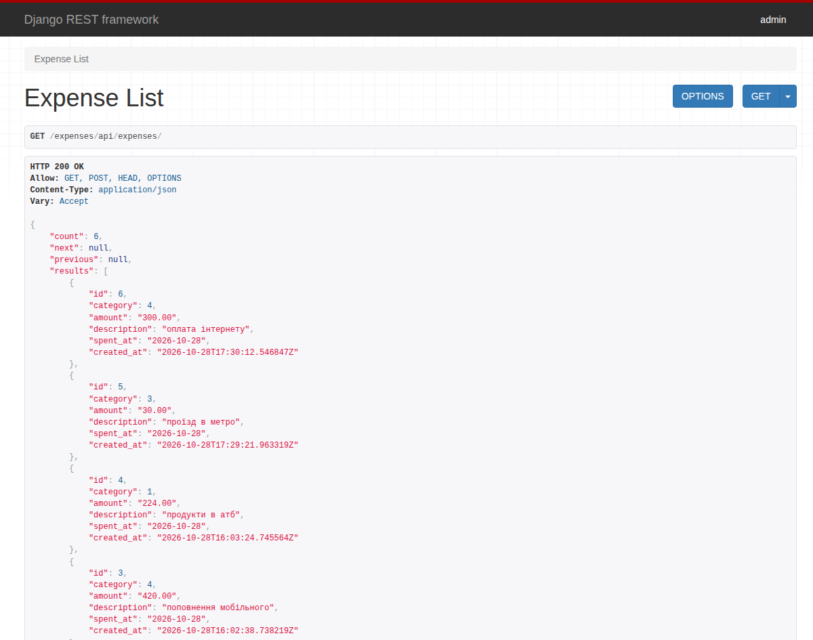

# Django Expense Tracker

[](https://github.com/luts26/django-expense-tracker/actions/workflows/ci.yml)

Personal expense tracker built with Django and Django REST Framework: per-user expenses and categories, token-authenticated REST API, category report, CSV export, and automated tests.

**Status:** In active development.

## Screenshots

| Expenses | Category report |
|---|---|
|  |  |



## Features

- User authentication using Django's built-in authentication system.
- Create, view, edit, and delete expenses.
- Create and view per-user categories and assign them to expenses.
- Per-user data isolation: users can access only their own expenses.
- Total expense calculation.
- Expenses ordered by date.
- Validation of positive amounts at the form and database levels.
- Edit categories; duplicate names are rejected per user.
- Category report with totals per category.
- CSV export of the user's expenses (formula-injection safe).
- REST API for expenses (Django REST Framework) with session and token authentication, pagination, and a `category` filter.
- Automated tests.

## Tech Stack

- Docker Compose
- Python
- Django
- Django REST Framework
- PostgreSQL
- SQLite (default)
- Django Templates
- HTML
- CSS

The original `JsonResponse` endpoints under `/expenses/api/` are kept alongside the Django REST Framework API under `/expenses/api/expenses/`.

## Local Setup

Clone the repository and enter its directory:

```bash
git clone https://github.com/luts26/django-expense-tracker.git
cd django-expense-tracker
```

Create and activate a virtual environment:

```bash
python3 -m venv .venv
source .venv/bin/activate
```

On Windows:

```powershell
.venv\Scripts\Activate.ps1
```

Install dependencies:

```bash
python -m pip install -r requirements.txt
```

Apply database migrations:

```bash
python manage.py migrate
```

Create a user:

```bash
python manage.py createsuperuser
```

Start the development server:

```bash
python manage.py runserver
```

Open the local address shown in the terminal and sign in using
the account you created.

## Running with Docker

Requires Docker with the Compose plugin.

Create your local environment file and set a db, user and password:

```bash
cp .env.example .env
```

Build and start the app and PostgreSQL:

```bash
docker compose up -d --build
```

The app applies migrations on start and is available at
`http://127.0.0.1:8000/expenses/`. Create a user:

```bash
docker compose exec web python manage.py createsuperuser
```

Run the tests inside the container:

```bash
docker compose exec web python manage.py test
```

Stop the containers (add `-v` to also delete the database volume):

```bash
docker compose down
```

PostgreSQL is also published on `127.0.0.1:5433`, so the project can run
from a local virtual environment against it:

```bash
export POSTGRES_DB=<value from .env> POSTGRES_USER=<value from .env> POSTGRES_PASSWORD=<value from .env> POSTGRES_PORT=5433
python manage.py migrate
```

Without the `POSTGRES_*` variables the project uses SQLite.

The container runs Django's development server and is not a production setup.

## Tests

Run the test suite:

```bash
python manage.py test
```

Run Django's system checks:

```bash
python manage.py check
```

Check for model changes without migrations:

```bash
python manage.py makemigrations --check --dry-run
```

## REST API

The API is available under `/expenses/api/expenses/` and requires authentication.

Obtain a token:

```bash
curl -X POST http://127.0.0.1:8000/expenses/api/token/ \
  -d "username=<username>" -d "password=<password>"
```

Use it in the `Authorization` header:

```bash
curl -H "Authorization: Token <token>" \
  http://127.0.0.1:8000/expenses/api/expenses/
```

| Endpoint | Description |
|---|---|
| `GET /expenses/api/expenses/` | Paginated list (10 per page) |
| `GET /expenses/api/expenses/?category=<id>` | Filter by category |
| `GET /expenses/api/expenses/?page=2` | Next page |
| `POST /expenses/api/expenses/` | Create an expense |
| `GET/PUT/PATCH/DELETE /expenses/api/expenses/<id>/` | Retrieve, update, or delete |

Treat tokens like passwords and do not commit them.

## Project Structure

```text
config/                 Django settings and root URL configuration
expenses/
    models.py           Expense and category models
    forms.py            Expense and category forms and validation
    serializers.py      Django REST Framework serializers
    api.py              Django REST Framework viewsets
    views.py            Web views, report, CSV export, and JSON endpoints
    urls.py             Expense routes
    tests.py            Automated tests
    migrations/         Database migrations
    templates/          Expense pages
static/
    css/                Stylesheet
templates/
    base.html           Base layout
    registration/       Login template
manage.py               Django management commands
Dockerfile
docker-compose.yml
requirements.txt        Python dependencies
```

## Data and Access Control

Each expense belongs to a user. List, edit, and delete operations
filter records by the authenticated owner.

Amounts use `DecimalField`. Validation and a database constraint
require an amount of at least `0.01`.

The REST API requires authentication (token or session) and returns only the authenticated user's data. Requests for another user's record return `404`, and a category that belongs to another user is rejected by validation.

## Development Notes

The default configuration is intended for local development,
using SQLite and `DEBUG=True`.

`DJANGO_SECRET_KEY` can be supplied through an environment variable.
The fallback key is for local development only.

Do not commit local databases, virtual environments, or secrets.
Production deployment requires separate security and hosting
configuration.

## Planned Improvements

- Add deletion for categories.
- Add date filters to the report.
